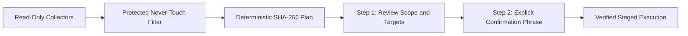
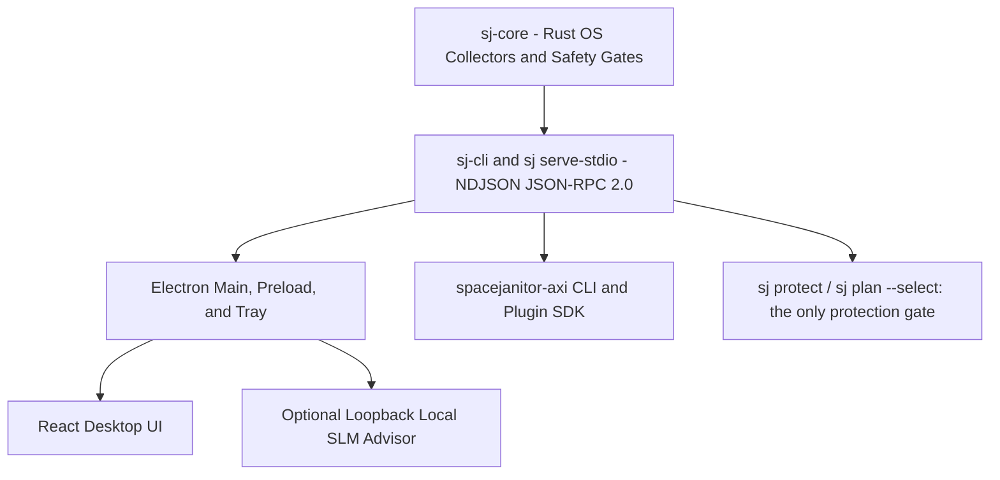

<div align="center">

# SpaceJanitor

**Cross-platform storage, true memory footprint, OS blocker forensics, and AI MCP sprawl auditor — zero silent deletions.**

[](https://github.com/adibirzu/spacejanitor/actions/workflows/ci.yml)
[](./LICENSE)
[](./docs/INSTALL.md)
[](./docs/ARCHITECTURE.md)

</div>

---

> **Project status:** the Rust core, all collectors, the AXI CLI, the SLM advisor and the Electron desktop app are on `main` and build from source. **No installer or npm package is published yet** (no release tag; the M7 release matrix has not run). See [Status](#status) and [Known limitations](#known-limitations).

## Why SpaceJanitor?

Standard utilities like `df` and `ps` mislead developers and AI-workstation users right before a machine freezes:

| What `df` / `ps` Show | What Is Actually Happening | How SpaceJanitor Fixes It |
|---|---|---|
| `ps` reports modest `RSS` per process | Tens of GiB sit in **compressed RAM and swap** across IDE, browser, and agent clusters | Measures **True Memory Footprint** (resident, compressed and swap) per process |
| Disk looks "fine" or `du` crawls | **Orphan git worktrees**, stale `target/`/`node_modules`, OS Trash, and APFS local snapshots eat SSD headroom | Runs bounded parallel scans; an **opt-in** recursive git clean/pushed proof marks safe orphan worktrees |
| Terminals & SSH hang with free CPU | **Kernel/VFS blockers** saturate macOS vnodes, `fseventsd`, Linux `inotify` watches, or Windows handles | Audits OS kernel/VFS tables **without** ever running recursive `lsof +D` |
| Dozens of background `node`/`python` PIDs | **Duplicated stdio MCP servers** multiply per editor/CLI session and leak tokens in CLI args | Audits MCP configs and live processes and **never prints inline secrets** |
| Orphan `PPID=1` agent scripts linger | `pkill`/`killall` risks killing active work | Re-verifies exact PID, command hash, and start time before gated `SIGTERM` (own-UID MCP-lineage processes only) |

---

## Key Capabilities

| Capability | Description | Status on `main` |
|---|---|---|
| **Storage, Trash & Orphan Hygiene** | Bounded parallel disk scans (`sj scan`), OS Trash / Recycle Bin audit (`sj trash`), and a recursive `.git` clean/pushed proof for abandoned worktrees (`sj orphans`, **opt-in**) | Shipped |
| **True Memory Footprint** | `sj memory` reports Resident + Compressed + Swap per process (top-N) with system pressure on macOS, Linux and Windows collectors | Shipped |
| **Kernel & VFS Blockers** | `sj blockers` inspects macOS vnodes/`fseventsd`/uninterruptible waits, Linux `file-nr`/`inotify`/`D`-state, and Windows handles/pagefile | Shipped |
| **MCP Fleet & Secret Audit** | `sj mcp-audit` finds duplicated stdio MCP servers across agent configs and live processes; output uses a closed vocabulary so inline secrets are never printed | Shipped |
| **LLM Plugin / Skill Audit** | `sj llm-audit` is a read-only inventory of unused plugins, skills, MCP servers and idle MCP sessions (no execute path) | Shipped |
| **Scoped `PPID=1` Reaper** | `sj reap` plans (dry-run) and executes termination of orphaned MCP-lineage processes owned by you, re-verifying PID, command hash and start time | Shipped (Unix) |
| **Rust protection gate** | `sj protect` and `sj plan --select` are the **only** protected-path decision point; the desktop app and Node CLI contain no copy of it and fail closed without `sj` | Shipped |
| **AXI CLI for AI Agents** | `spacejanitor-axi` emits compact TOON (default) or versioned `spacejanitor.*.v1` JSON; collectors call `sj` and fall back to read-only Node views | Shipped (from source) |
| **Sidecar protocol** | `sj serve-stdio` speaks newline-delimited JSON-RPC 2.0 for GUI hosts | Shipped |
| **Optional Local SLM Advisor** | On-demand, loopback-only advisor (`spacejanitor-axi advise --slm-url`, desktop drawer); no execution capability | Shipped |
| **Electron Desktop App** | Tray-first app with two-step confirmation; every removal goes through `sj` | Shipped (build from source; **no installer published yet**) |

---

## How It Works (Dry-Run First, Safety-Gated Execution)

SpaceJanitor **never deletes a file or signals a process by default**. Every sweep produces a deterministic dry-run plan bound to a SHA-256 digest and requires explicit two-step confirmation.



> **Protected-path gate (Rust only)**
>
> Enforced in `crates/sj-core/src/protect.rs` and exposed as `sj protect`. There is **no JavaScript denylist**: the desktop app and `packages/core` forward every path to `sj` and treat anything they cannot prove as protected.
> - **Credential & Agent Stores:** `~/.ssh`, `~/.gnupg`, `~/.aws`, `~/.kube`, `~/.claude`, `~/.config/gh`, `.env*`, `*.pem`, `*.key`, `*.p12`, `*.pfx`, `id_rsa*`, `id_ed25519*`
> - **VM & Disk Images:** `*.vmdk`, `*.qcow2`, `*.vhdx`, `*.vdi`, `*.raw`, `*.img`
> - **OS System Roots & Home:** `/`, `/System`, `/usr`, `/bin`, `/sbin`, `/etc`, `/Library`, `/private/etc`, `/private/var/db`, `/Windows`, `C:\Windows`, and `$HOME`
> - **Symlink & Traversal Defense:** canonicalizes ancestors and fails closed on dangling symlinks or symlinks pointing into protected targets. Extra user rules (`--exact`, `--dynamic`, `--glob`) can only add protection.
> - **Selection-bound confirmation:** `sj plan --select <path>...` reports a `selection_sha256` over exactly the chosen items (including their size/mtime/content snapshot). `--execute --confirm --selection-sha256 <digest>` rebuilds the plan and refuses unless the same selection hashes to the confirmed digest.

---

## Top Use Cases

| Scenario | Read-Only Entry Point | Guide |
|---|---|---|
| **1. Runaway Disk Exhaustion** | `sj scan` / `sj trash` / `sj orphans --include-orphans` (opt-in) | [Use Case 1](./docs/USE_CASES.md#1-runaway-disk-exhaustion) |
| **2. Hidden Memory & Swap Thrashing** | `sj memory --top 15` | [Use Case 2](./docs/USE_CASES.md#2-hidden-memory--swap-thrashing) |
| **3. Kernel & VFS OS Blockers** | `sj blockers` | [Use Case 3](./docs/USE_CASES.md#3-kernel--vfs-os-blockers) |
| **4. AI Agent MCP Sprawl & Inline Secret Leaks** | `sj mcp-audit` | [Use Case 4](./docs/USE_CASES.md#4-ai-agent-mcp-server-sprawl--inline-secret-leaks) |
| **5. Safe `PPID=1` Orphan Process Reaping** | `sj reap` (dry-run default) | [Use Case 5](./docs/USE_CASES.md#5-safe-ppid1-orphan-process-reaping) |
| **6. Agent-First Automation (AXI) & Local SLM Advisor** | `node packages/cli/bin/spacejanitor.mjs summary` | [Use Case 6](./docs/USE_CASES.md#6-agent-first-automation-axi--optional-local-slm-advisor) |

---

## Architecture at a Glance



For process boundaries, IPC allowlists, and the cross-platform collector matrix, see [docs/ARCHITECTURE.md](./docs/ARCHITECTURE.md).

---

## Quick Installation & Quick Start

> **No installer is published yet.** No release tag exists and the M7 release matrix (`.dmg`, `.AppImage`, `.deb`, `.exe`, `.msi`, `SHA256SUMS.txt`) has not been run, so GitHub Releases is empty. Build from source today. See [docs/INSTALL.md](./docs/INSTALL.md).

### Rust `sj` CLI (from source)

```bash
git clone https://github.com/adibirzu/spacejanitor.git
cd spacejanitor
cargo build --release --workspace

# Read-only diagnostics
./target/release/sj doctor
./target/release/sj scan ~/dev --depth 3
./target/release/sj trash
./target/release/sj memory --top 15
./target/release/sj blockers
./target/release/sj mcp-audit
./target/release/sj llm-audit

# Orphan worktrees are OFF by default; opt in only for repositories you trust
./target/release/sj orphans ~/dev --depth 4 --include-orphans

# Dry-run plan (add --include-orphans only if you opted in)
./target/release/sj plan ~/dev --include-trash
```

### AXI CLI & Agent Skill (`spacejanitor-axi`, from source)

```bash
node packages/cli/bin/spacejanitor.mjs summary
node packages/cli/bin/spacejanitor.mjs doctor --json
```

The package is not published to npm yet, so `npx spacejanitor-axi` does not work today. Collectors call the built `sj` when it can be found (see [docs/INSTALL.md](./docs/INSTALL.md)) and otherwise fall back to read-only Node views; the Node CLI never executes a remediation.

### Desktop app (from source)

```bash
npm install
cargo build --release -p sj-cli
npm run desktop:build
```

See [docs/USAGE.md](./docs/USAGE.md) for the full command reference.

---

## Documentation Map

| Document | Contents |
|---|---|
| [docs/USE_CASES.md](./docs/USE_CASES.md) | Walkthroughs for the six workstation failure modes |
| [docs/ARCHITECTURE.md](./docs/ARCHITECTURE.md) | Components, selection-bound confirmation sequence, IPC boundary, collector matrix |
| [docs/INSTALL.md](./docs/INSTALL.md) | Build from source; planned installers and checksum verification |
| [docs/USAGE.md](./docs/USAGE.md) | `sj` and `spacejanitor-axi` reference, desktop guide, FAQ |
| [docs/SECURITY.md](./docs/SECURITY.md) | Threat model, protection gate, redaction vocabulary, open hardening items |
| [docs/adr/](./docs/adr/ADR-001-desktop-runtime-tauri-vs-electron.md) | Architecture Decision Records (ADR-001 to ADR-005) with implementation status |
| [docs/prd/](./docs/prd/PRD-001-core-storage-and-orphan-work-engine.md) | Product Requirements (PRD-001 to PRD-005) with per-requirement status |

---

## Status

| Milestone | Scope | State on `main` |
|---|---|---|
| **M1** | `sj-core` / `sj-cli`: protection gate, `scan`, `trash`, `orphans`, `plan`, `doctor` | Shipped |
| **M2** | `sj memory`, `sj blockers`, `sj mcp-audit`, `sj llm-audit` | Shipped (PR #15) |
| **M3** | Scoped `PPID=1` reaper (`sj reap`) | Shipped, Unix only (PR #15) |
| **M4** | `sj serve-stdio`, AXI collector wiring | Shipped (PR #10) |
| **M5** | Electron desktop app (`apps/desktop`, `apps/ui`), all removals through `sj` | Shipped from source (PR #10, #11) |
| **M6** | Optional loopback local SLM advisor | Shipped (PR #10) |
| **M7** | Release pipeline (`.github/workflows/release.yml`) | Workflow exists; **never run, no tag, no published artifacts** |
| Linux extension | Linux audit, systemd/podman blockers, memory, gated remediation | Open in [PR #18](https://github.com/adibirzu/spacejanitor/pull/18), not merged |

Open hardening items: [#12](https://github.com/adibirzu/spacejanitor/issues/12) (git-proof hardening), [#16](https://github.com/adibirzu/spacejanitor/issues/16) (Windows no-follow config reads), [#17](https://github.com/adibirzu/spacejanitor/issues/17) (slow TOML parse on huge malformed input).

---

## Known limitations

- **Orphan-repo scanning is OFF by default (experimental).** Finding and pruning orphan git worktrees runs `git` (status, ls-remote, config reads, worktree remove) inside repositories found on disk, including repositories SpaceJanitor did not create. An independent review showed a repository's own configuration can still steer that git in ways our proofs do not yet block:
  - **B35:** a clean filter in a submodule's own config can still run during the read-only status proof.
  - **B36:** repository `http.<url>.proxy` plus disabled TLS verification can redirect `ls-remote` credentials.
  - **B37:** timeouts and budgets are not a hard contract (git calls have a 25 s timeout, but some config reads have none, so a FIFO at `.git/config` can still hang a scan).

  Tracked in [issue #12](https://github.com/adibirzu/spacejanitor/issues/12). By default no git command touches any repository (`doctor` only runs `git --version`). Opt in only for repositories you trust: `sj orphans --include-orphans`, `sj plan --include-orphans`, `spacejanitor-axi orphans --include-orphans`, or the explicit toggle in the desktop app (Disk view). When scanning is off, the desktop app shows orphan worktrees as "not scanned (disabled by default)", never as "no orphans". Trash cleanup, the confirmation gate, the protection gate, redaction, MCP audit and the SLM advisor are unaffected.
- **Removal is Unix-only.** `sj plan --execute` and `sj reap --execute` run on macOS and Linux; on Windows `plan --execute` is refused and `sj reap` finds no eligible targets.
- **Windows config reads** do not yet open MCP config files no-follow (issue #16), and a huge malformed TOML config can parse slowly (issue #17).
- **No signed installers.** Nothing is published; when releases start they will be unsigned until code signing and notarization are enabled.

---

## Contributing & License

Contributions are welcome. Read [CONTRIBUTING.md](./CONTRIBUTING.md) first. Every PR runs `cargo test --workspace`, `npm test`, the desktop tests, `npm run hygiene` (`scripts/check-oss-hygiene.mjs`) and `gitleaks`.

Licensed under the [MIT License](./LICENSE).
