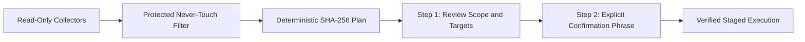
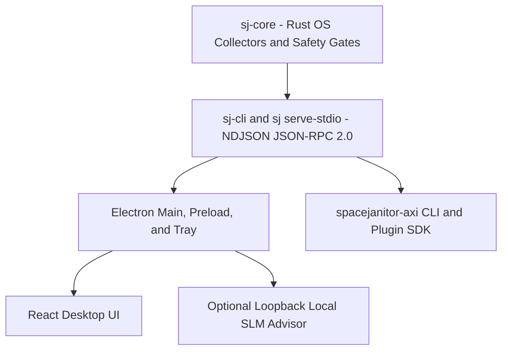

<div align="center">

# SpaceJanitor

**Cross-platform storage, true memory footprint, OS blocker forensics, and AI MCP sprawl auditor — zero silent deletions.**

[](https://github.com/adibirzu/spacejanitor/actions/workflows/ci.yml)
[](./LICENSE)
[](./docs/INSTALL.md)
[](./docs/ARCHITECTURE.md)

</div>

---

> **Project Status (M1 Shipped vs. M2–M7 Planned):**
> - **Shipped today (`M1`):** Rust core engine (`sj-core`) and CLI (`sj-cli`: `doctor`, `scan`, `trash`, `orphans`, `plan`), deterministic SHA-256 `spacejanitor.proposal.v1` execution gate, `protect.rs` denylist, and `spacejanitor-axi doctor` (from source).
> - **In Progress / Planned (`M2`–`M7`):** `sj memory` and `sj blockers` (`M2`), `sj mcp-audit` and `sj reap` (`M3`), `sj serve-stdio` and full `spacejanitor-axi` collectors (`M4`), Electron Desktop Tray App (`M5`), Local SLM Advisor (`M6`), and signed/checksum-verified GitHub Releases (`M7`).

## Why SpaceJanitor?

Standard utilities like `df` and `ps` mislead developers and AI-workstation users right before a machine freezes:

| What `df` / `ps` Show | What Is Actually Happening | How SpaceJanitor Fixes It |
|---|---|---|
| `ps` reports modest `RSS` per process | Tens of GiB sit in **compressed RAM and swap** across IDE, browser, and agent clusters | Measures **True Memory Footprint** (`Resident + Compressed + Swap`) grouped by owner |
| Disk looks "fine" or `du` crawls | **Orphan git worktrees**, stale `target/`/`node_modules`, OS Trash, and APFS local snapshots eat SSD headroom | Runs bounded parallel scans with **recursive git clean/pushed proofs** |
| Terminals & SSH hang with free CPU | **Kernel/VFS blockers** saturate macOS vnodes, `fseventsd`, Linux `inotify` watches, or Windows handles | Audits OS kernel/VFS tables **without** ever running recursive `lsof +D` |
| Dozens of background `node`/`python` PIDs | **Duplicated stdio MCP servers** multiply per editor/CLI session and leak tokens in CLI args | Groups MCP fleets by parent agent and **automatically redacts inline secrets** |
| Orphan `PPID=1` agent scripts linger | `pkill`/`killall` risks killing active work | Re-verifies exact PID, command, and start time before gated `SIGTERM` |

---

## Key Capabilities

| Capability | Description | Target |
|---|---|---|
| **Storage & Orphan Hygiene** | Bounded parallel disk scans, OS Trash / Recycle Bin audit, and recursive `.git` clean/pushed proof for abandoned worktrees | M1 (shipped) |
| **True Memory Footprint** | Attributes Resident + Compressed + Swap memory by logical owner group (`MCP Fleet`, `VMs`, `Agent CLIs`, `OS Daemons`) | M2 |
| **Kernel & VFS Blockers** | Inspects macOS vnodes/`fseventsd`/Mach ports, Linux `file-nr`/`inotify`/`D`-state, and Windows handles/pagefile | M2 |
| **MCP Fleet & Secret Audit** | Detects duplicated stdio MCP servers across agent configs and redacts inline `--api-key`, bearer, and URL credentials | M3 |
| **Safe `PPID=1` Reaper** | Identifies orphaned `PPID=1` processes and stages dry-run reaping with exact PID + start-time re-verification | M3 |
| **AXI CLI for AI Agents** | `spacejanitor-axi` (`npx spacejanitor-axi` once published to npm; `doctor` shipped in M1, collectors in M4) emits compact TOON output by default and versioned `spacejanitor.*.v1` JSON with `--json` | M1 (`doctor`) / M4 / M7 |
| **Optional Local SLM Advisor** | On-demand `127.0.0.1`-only local LLM (0.5B–1.5B GGUF / Ollama) for plain-English plan explanations (`0 MiB` idle) | M6 |
| **Multi-OS Desktop Tray App** | Electron tray utility (`macOS`, `Linux`, `Windows` on `x64` & `arm64`) that destroys `BrowserWindow` on close | M5 / M7 |

---

## How It Works (Dry-Run First, Safety-Gated Execution)

SpaceJanitor **never deletes a file or signals a process by default**. Every sweep produces a deterministic dry-run plan bound to a SHA-256 digest and requires explicit two-step confirmation.



> **Immutable Protected Never-Touch Denylist**
>
> Enforced in Rust (`crates/sj-core/src/protect.rs`) across all built-in rules, plugins, and optional SLM suggestions:
> - **Credential & Agent Stores:** `~/.ssh`, `~/.gnupg`, `~/.aws`, `~/.kube`, `~/.claude`, `~/.config/gh`, `.env`, `.env.*`, `*.env`, `*.private.*`, `*.pem`, `*.key`, `*.p12`, `*.pfx`, `id_rsa`, `id_rsa.*`, `id_ed25519`, `id_ed25519.*`, `id_ecdsa`, `id_ecdsa.*`, `id_dsa`, `id_dsa.*`
>   *(Note: custom suffix names without a dot, such as `id_rsa_work` or `.envrc`, are not matched by the default filename rule unless placed inside a protected directory such as `~/.ssh`.)*
> - **VM & Disk Images:** `*.vmdk`, `*.qcow2`, `*.vhdx`, `*.vdi`, `*.raw`, `*.img`
> - **OS System Roots & Home:** `/`, `/System`, `/usr`, `/bin`, `/sbin`, `/etc`, `/Library`, `/private/etc`, `/private/var/db`, `/Windows`, `C:\Windows`, and `$HOME`
> - **Symlink & Traversal Defense:** Canonicalizes ancestors and fails closed on dangling symlinks or symlinks pointing into protected targets.

---

## Top Use Cases

| Scenario | Read-Only Entry Point | Guide |
|---|---|---|
| **1. Runaway Disk Exhaustion** | `sj scan` / `sj orphans` / `sj trash` | [Use Case 1](./docs/USE_CASES.md#1-runaway-disk-exhaustion) |
| **2. Hidden Memory & Swap Thrashing** *(M2)* | `sj memory --top 15` | [Use Case 2](./docs/USE_CASES.md#2-hidden-memory--swap-thrashing) |
| **3. Kernel & VFS OS Blockers** *(M2)* | `sj blockers` | [Use Case 3](./docs/USE_CASES.md#3-kernel--vfs-os-blockers) |
| **4. AI Agent MCP Sprawl & Inline Secret Leaks** *(M3)* | `sj mcp-audit` | [Use Case 4](./docs/USE_CASES.md#4-ai-agent-mcp-server-sprawl--inline-secret-leaks) |
| **5. Safe `PPID=1` Orphan Process Reaping** *(M3)* | `sj reap --dry-run` | [Use Case 5](./docs/USE_CASES.md#5-safe-ppid1-orphan-process-reaping) |
| **6. Agent-First Automation (AXI) & Local SLM Advisor** *(M1 `doctor` / M4 / M6)* | `node packages/cli/bin/spacejanitor.mjs doctor` *(or `spacejanitor-axi summary` once M4 + npm publish land)* | [Use Case 6](./docs/USE_CASES.md#6-agent-first-automation-axi--optional-local-slm-advisor) |

---

## Architecture at a Glance



For process boundaries, IPC allowlists, and the cross-platform collector matrix, see [docs/ARCHITECTURE.md](./docs/ARCHITECTURE.md).

---

## Quick Installation & Quick Start

### Desktop App (GitHub Releases — M5 / M7)

Download checksum-verified installers (unsigned until code signing & notarization are enabled; Planned M7) from [GitHub Releases](https://github.com/adibirzu/spacejanitor/releases):

- **macOS Universal (`arm64` + `x64`):** `.dmg`, `.zip`
- **Linux (`x64` & `arm64`):** `.AppImage`, `.deb`
- **Windows (`x64` & `arm64`):** `.exe` (NSIS installer), `.msi`

### Rust `sj` CLI (From Source — M1 Ready Today)

```bash
git clone https://github.com/adibirzu/spacejanitor.git
cd spacejanitor
cargo build --release --workspace

# Run read-only diagnostics
./target/release/sj doctor --json
./target/release/sj scan ~/dev --depth 3
./target/release/sj trash
./target/release/sj orphans ~/dev --depth 4
./target/release/sj plan ~/dev --include-trash --include-orphans
```

### AXI CLI & Agent Skill (`spacejanitor-axi`)

```bash
# Run from source today (M1: doctor is live; other collectors return scaffold until M4)
node packages/cli/bin/spacejanitor.mjs doctor
node packages/cli/bin/spacejanitor.mjs doctor --json

# Compact TOON output via npx (once published to npm)
npx spacejanitor-axi doctor
```

See [docs/INSTALL.md](./docs/INSTALL.md) for checksum verification and platform-specific notes, and [docs/USAGE.md](./docs/USAGE.md) for the full command reference.

---

## Documentation Map

| Document | Contents |
|---|---|
| [docs/USE_CASES.md](./docs/USE_CASES.md) | Step-by-step walkthroughs for all 6 workstation failure modes |
| [docs/ARCHITECTURE.md](./docs/ARCHITECTURE.md) | Component diagram, 2-step SHA-256 sequence, IPC sandbox, OS collector matrix |
| [docs/INSTALL.md](./docs/INSTALL.md) | Desktop installers, `SHA256SUMS.txt` verification, Rust CLI, AXI skill, Local SLM |
| [docs/USAGE.md](./docs/USAGE.md) | Complete `sj` & `spacejanitor-axi` CLI reference, Desktop Tray UI guide, FAQ |
| [docs/SECURITY.md](./docs/SECURITY.md) | Threat model, Protected Denylist, secret redaction, sandbox & disclosure policy |
| [docs/adr/](./docs/adr/ADR-001-desktop-runtime-tauri-vs-electron.md) | Architecture Decision Records (ADR-001 through ADR-005) |
| [docs/prd/](./docs/prd/PRD-001-core-storage-and-orphan-work-engine.md) | Product Requirements Documents (PRD-001 through PRD-005) |

---

## Roadmap

| Milestone | Scope | Status |
|---|---|---|
| **M1** | Rust Core (`sj-core`, `sj-cli`): protection denylist, `scan`, `trash`, `orphans`, `plan`, `doctor` | Shipped |
| **M2** | True Memory Footprint (`sj memory`), Kernel/VFS Blockers (`sj blockers`) | In Progress |
| **M3** | MCP Fleet & Secret Audit (`sj mcp-audit`), Safe `PPID=1` Orphan Process Reaper (`sj reap`) with PID + start-time re-verification | Planned |
| **M4** | NDJSON JSON-RPC 2.0 sidecar (`sj serve-stdio`) & full `spacejanitor-axi` collector wiring | Planned |
| **M5** | Electron Desktop Tray App (`apps/desktop`, `apps/ui`) for macOS, Linux, Windows (`x64` + `arm64`) | Planned |
| **M6** | Optional Loopback Local SLM Advisor (`0.5B`–`1.5B` GGUF / Ollama) with grammar constraints | Planned |
| **M7** | Automated GitHub Releases (`.dmg`, `.zip`, `.AppImage`, `.deb`, `.exe`, `.msi`, `SHA256SUMS.txt`) | Planned |

---

## Contributing & License

Contributions are welcome! Please read [CONTRIBUTING.md](./CONTRIBUTING.md) before opening a pull request. Every PR runs `cargo test --workspace`, `npm test`, `npm run hygiene` (`scripts/check-oss-hygiene.mjs`), and `gitleaks`.

Licensed under the [MIT License](./LICENSE).
