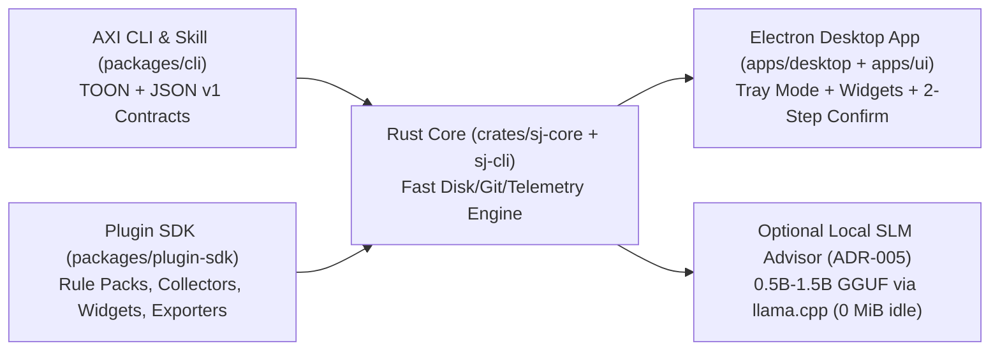

# SpaceJanitor

**Cross-platform workstation janitor (Rust core + Electron desktop shell + AXI CLI + optional local SLM advisor) for storage, orphan work, trash, true memory footprint, and OS-blocker forensics.**

Designed for **macOS**, **Linux**, and **Windows** (`x86_64` and `ARM64`), built around strict dry-run defaults, an immutable protected-path denylist, and zero cloud telemetry.

---

## Why SpaceJanitor Exists

Traditional disk cleaners clear browser caches. Developer disk cleaners delete `node_modules`. Neither protects against the failure modes that freeze AI-heavy engineering workstations:

1. **Orphan work & unpushed git worktrees** left behind by background coding agents, CI runners, and parallel IDE sessions.
2. **Hidden memory & swap thrash** where plain `ps` RSS hides tens of gigabytes of compressed RAM and encrypted swap.
3. **Kernel & VFS OS blockers** such as saturated macOS vnode tables, runaway `fseventsd` queues, Linux `inotify` exhaustion, recursive `lsof +D` tree locks, and orphaned `PPID=1` agent scripts.
4. **MCP server multiplication** where globally configured stdio MCP servers (`npx` / Node / Python) multiply across dozens of concurrent agent sessions.
5. **OS Trash & Recycle Bin bloat** sitting silently beside multi-gigabyte container and VM images.

Orphan-repo scanning (item 1) is **experimental and off by default**; see [Known limitations](#known-limitations). SpaceJanitor **never deletes a file or signals a process by default**. Every sweep produces a deterministic dry-run plan and requires explicit, two-step confirmation gated behind an immutable protected-path denylist.

---

## Architecture Overview



---

## Safety Invariants

- **Dry-run by default:** Scans and reports never mutate files, git repositories, or processes.
- **Two-step confirmation:** Execution requires a single-use token bound to the exact dry-run plan plus explicit target selection.
- **Git safety proof:** Worktree and repository cleanup rules refuse any tree with uncommitted changes, missing remotes, or unpushed commits—including nested sub-repositories.
- **Immutable Protected Denylist:** Core protections (`.ssh`, `.gnupg`, keystores, active IDE sessions, user-configured protected paths) override all built-in rules, plugins, and SLM proposals.
- **Zero telemetry & automatic redaction:** All telemetry stays local; CLI arguments matching credential shapes are redacted before leaving any collector or reaching an optional local SLM.

---

## Documentation

### Research & Architecture Decisions
- [001 — Competitive Landscape & Desktop Runtime Research](./docs/research/001-landscape-and-runtime-research.md)
- [ADR-001 — Rust Core + Thin Electron Desktop Shell](./docs/adr/ADR-001-desktop-runtime-tauri-vs-electron.md)
- [ADR-002 — Cross-Platform OS Telemetry & Orphan Safety](./docs/adr/ADR-002-cross-platform-os-telemetry-and-orphan-safety.md)
- [ADR-003 — AXI CLI Output & Plugin SDK Contract](./docs/adr/ADR-003-axi-cli-and-plugin-contract.md)
- [ADR-004 — Zero-Leak Privacy & Two-Step Remediation Gate](./docs/adr/ADR-004-privacy-zero-leak-and-two-step-remediation.md)
- [ADR-005 — On-Demand Tiny Local SLM Cleanup Advisor (0.5B–1.5B GGUF)](./docs/adr/ADR-005-local-slm-cleanup-advisor.md)

### Product Requirements Documents (PRDs)
- [PRD-001 — Core Storage, Trash & Orphan Work Engine](./docs/prd/PRD-001-core-storage-and-orphan-work-engine.md)
- [PRD-002 — True Memory Footprint & OS-Blocker Forensics](./docs/prd/PRD-002-memory-footprint-and-os-blocker-forensics.md)
- [PRD-003 — Cross-Platform Desktop App (macOS, Linux, Windows x64/ARM64)](./docs/prd/PRD-003-cross-platform-desktop-app.md)
- [PRD-004 — AXI CLI (`spacejanitor-axi`) & Plugin Ecosystem](./docs/prd/PRD-004-axi-cli-and-plugin-ecosystem.md)
- [PRD-005 — On-Demand Local SLM Cleanup & Forensics Advisor](./docs/prd/PRD-005-local-slm-cleanup-advisor.md)

---

## Quick Start (Scaffold)

Requirements: Node.js `>=20`, plus Rust toolchain (`cargo`) for native Rust core builds.

```bash
npm test
npm run hygiene
node packages/cli/bin/spacejanitor.mjs doctor --json
cargo test --workspace
```

---

## License

[MIT](./LICENSE)

---

## Known limitations

- **Orphan-repo scanning is OFF by default (experimental).** Finding and pruning orphan git worktrees runs `git` (status, ls-remote, config reads, worktree remove) inside repositories found on disk, including repositories SpaceJanitor did not create. An independent review showed a repository's own configuration can still steer that git in ways our proofs do not yet block:
  - **B35:** a clean filter in a submodule's own config can still run during the read-only status proof.
  - **B36:** repository `http.<url>.proxy` plus disabled TLS verification can redirect `ls-remote` credentials.
  - **B37:** timeouts and budgets are not a hard contract (a stalled remote or a FIFO at `.git/config` can hang a scan).

  Tracked in [issue #12](https://github.com/adibirzu/spacejanitor/issues/12). By default no git command touches any repository (`doctor` only runs `git --version`). Until that is fixed, opt in only for repositories you trust: `spacejanitor orphans --include-orphans`, `sj orphans --include-orphans`, `sj plan --include-orphans`, or the explicit toggle in the desktop app (Disk view). Every opt-in prints or shows a warning. When scanning is off, the desktop app shows orphan worktrees as "not scanned (disabled by default)", never as "no orphans". Trash and cache cleanup, the two-step confirmation gate, the protected-path denylist, redaction, MCP audit and the SLM advisor are unaffected.
