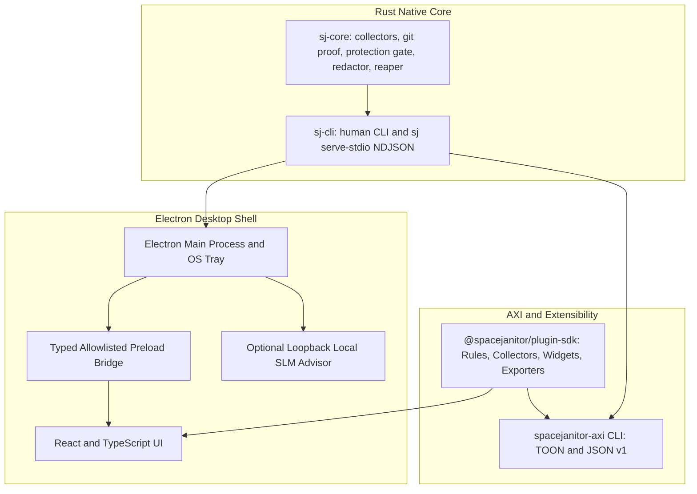

# SpaceJanitor Architecture

SpaceJanitor uses a **two-layer hybrid architecture**: a native **Rust core engine** (`crates/sj-core` + `crates/sj-cli`, binary `sj`) and a thin, tray-first **Electron desktop shell** (`apps/desktop` + `apps/ui`), plus an **AXI CLI & Plugin SDK** (`packages/cli`, `packages/core`, `packages/plugin-sdk`) and an **optional loopback-only Local SLM Advisor**. The runtime choice is recorded in [ADR-001](./adr/ADR-001-desktop-runtime-tauri-vs-electron.md) (decided: Electron plus Rust core).

> **State on `main`:** all components above are implemented and build from source. **No installer or npm package is published** (no release tag; the M7 release matrix has not run). Linux-specific extensions are in the still-open [PR #18](https://github.com/adibirzu/spacejanitor/pull/18).

---

## Design Principles

1. **Dry-run default.** Every collector and planner is read-only. Mutating operations require a two-step gate bound to a deterministic SHA-256 digest.
2. **Rust `sj` is the only protection gate.** Path protection, descendant walks, git proofs, redaction and execution live in `crates/sj-core`. The Node denylist was removed: `packages/core/src/protect.mjs` and the Electron main process forward every path to `sj` and treat anything unprovable as protected. If `sj` is missing, not executable, times out or returns unparseable output, every destructive action is refused while read-only views keep working.
3. **Orphan-repo scanning is opt-in.** Anything that runs `git` inside repositories found on disk is off unless `--include-orphans` (CLI) or the confirmed desktop toggle is used. See [issue #12](https://github.com/adibirzu/spacejanitor/issues/12).
4. **Minimal tray footprint.** Closing the window destroys the `BrowserWindow` renderer, dropping Chromium's idle renderer cost while the main process and tray stay resident.
5. **Fail closed.** Unreadable directories, dangling symlinks, unverifiable UIDs or recycled PIDs make `sj-core` deny or abort rather than guess.

---

## Component Architecture



---

## Selection-Bound Remediation Sequence

Every destructive desktop action follows the same handshake. The confirmation token is a digest of **exactly the items the user selected**, not of the whole plan, so a changed selection or a changed file invalidates it.

```mermaid
sequenceDiagram
  participant User as Operator / UI
  participant Main as Electron Main (session only)
  participant Sj as sj (Rust gate)
  participant OS as Filesystem

  User->>Main: Select candidates
  Main->>Sj: sj protect --json (read-only annotations)
  Main->>Sj: sj plan <root> --json --select <path>...
  Sj->>OS: Read-only scan, protection gate, snapshot (dev/ino/size/mtime/content)
  Sj-->>Main: selection.selection_sha256 (the token)
  Main-->>User: Step 1: targets, bytes, digest, CONFIRM-XXXXXXXX phrase (5 min, single use)

  User->>Main: Step 2: type phrase
  Main->>Sj: sj plan <root> --execute --confirm --selection-sha256 <token> --select <path>...
  Sj->>Sj: Rebuild plan; refuse unless the same selection hashes to the token
  Sj->>OS: Remove no-follow, entry by entry, re-checking at execute time
  Sj-->>Main: Executed report
```

CLI users run the same two steps by hand (`sj plan --select ...` then `--execute --confirm --selection-sha256 ...`), or use the single-item form (`--execute --confirm --plan-sha256 <sha> --item <id>`). `sj reap` uses its own digest and a plan-specific confirm phrase and re-verifies PID, command hash and start time at execute time.

---

## Process & IPC Boundary Model

### Electron sandbox invariants (`apps/desktop`)
- **`contextIsolation: true`**, **`nodeIntegration: false`**, **`sandbox: true`** on all renderer windows.
- **Typed, validated IPC:** `preload` exposes only explicit channels; `ipcValidation.ts` validates every payload. The orphan opt-in can only be turned on through a native confirmation dialog opened by the main process.
- **No shell interpolation:** `sj` and git are launched with argument arrays (`shell: false`).
- **`sj` location:** absolute path only, never `PATH` or the cwd. Packaged apps use `<resources>/bin/sj`; unpackaged dev builds accept an absolute `SPACEJANITOR_SJ_BIN` or `target/{release,debug}`. `SPACEJANITOR_NO_SJ=1` forces the fail-closed state.
- **Close-to-tray lifecycle:** closing the window destroys the renderer; reopening from the tray recreates it.

### Sidecar protocol (`sj serve-stdio`)
- NDJSON JSON-RPC 2.0 on `stdin`/`stdout`. Methods: `doctor`, `scan`, `trash`, `orphans`, `memory`, `blockers`, `mcp_audit`, `llm_audit`, `plan_reap`, `execute_reap`, `plan_cleanup`, `execute_cleanup`. Notifications (no `id`) get no response.
- Responses use versioned `spacejanitor.*.v1` envelopes (`doctor`, `storage`, `trash`, `orphans`, `proposal`, `memory`, `blockers`, `mcp_audit`, `llm_audit`, `reap`, `protect`, plus `summary`/`disk`/`plan` in the Node AXI layer).

### AXI CLI
`spacejanitor-axi` calls `sj <cmd> --json` (absolute path, bounded timeout) and falls back to read-only Node collectors. The Node path can never execute: `--execute` fails closed there and points to the desktop app or `sj`.

---

## Cross-Platform Collector Matrix

| Domain | macOS (`arm64`/`x64`) | Linux (`x64`/`arm64`) | Windows (`x64`/`arm64`) |
|---|---|---|---|
| **Storage & Trash** | `jwalk` inode-deduped scan, `~/.Trash` | `jwalk` scan, `$XDG_DATA_HOME/Trash` | `jwalk` scan, `$Recycle.Bin` |
| **True memory footprint** | `top`, `vm_stat`, `sysctl vm.swapusage` | `/proc/<pid>/smaps_rollup` (`Pss` + `SwapPss`), `/proc/meminfo` | WMI/CIM process data, pagefile |
| **Kernel / VFS blockers** | `kern.num_vnodes`/`maxvnodes`, `fseventsd`, `U`-state waits | `/proc/sys/fs/file-nr`, `fs.inotify.*`, `D`-state | handle counts, pool and pagefile pressure |
| **Orphan work** (opt-in) | recursive `.git` proof | recursive `.git` proof | recursive `.git` proof |
| **`PPID=1` reaper** | own-UID MCP-lineage only, non-recursive cwd checks | own-UID MCP-lineage only, `/proc` | no eligible targets (UID unverifiable) |
| **Removal (`--execute`)** | handle-anchored, no-follow | handle-anchored, no-follow | **refused** (plan only) |

Collectors never run recursive `lsof +D`. Linux systemd/podman blockers and extra Linux audit coverage are in open [PR #18](https://github.com/adibirzu/spacejanitor/pull/18).

---

## Architecture Decision Records & PRDs

- **ADRs:**
  - [ADR-001 — Desktop & Core Architecture (Rust Core + Electron Shell)](./adr/ADR-001-desktop-runtime-tauri-vs-electron.md)
  - [ADR-002 — Cross-Platform OS Telemetry & Orphan Safety Model](./adr/ADR-002-cross-platform-os-telemetry-and-orphan-safety.md)
  - [ADR-003 — AXI CLI Output & Extensible Plugin Contract](./adr/ADR-003-axi-cli-and-plugin-contract.md)
  - [ADR-004 — Zero-Leak Privacy & Two-Step Remediation Gate](./adr/ADR-004-privacy-zero-leak-and-two-step-remediation.md)
  - [ADR-005 — On-Demand Tiny Local SLM Cleanup Advisor](./adr/ADR-005-local-slm-cleanup-advisor.md)
- **PRDs:**
  - [PRD-001 — Core Storage, Trash & Orphan Work Engine](./prd/PRD-001-core-storage-and-orphan-work-engine.md)
  - [PRD-002 — True Memory Footprint & OS-Blocker Forensics](./prd/PRD-002-memory-footprint-and-os-blocker-forensics.md)
  - [PRD-003 — Cross-Platform Desktop App](./prd/PRD-003-cross-platform-desktop-app.md)
  - [PRD-004 — AXI CLI & Plugin Ecosystem](./prd/PRD-004-axi-cli-and-plugin-ecosystem.md)
  - [PRD-005 — On-Demand Local SLM Cleanup Advisor](./prd/PRD-005-local-slm-cleanup-advisor.md)
