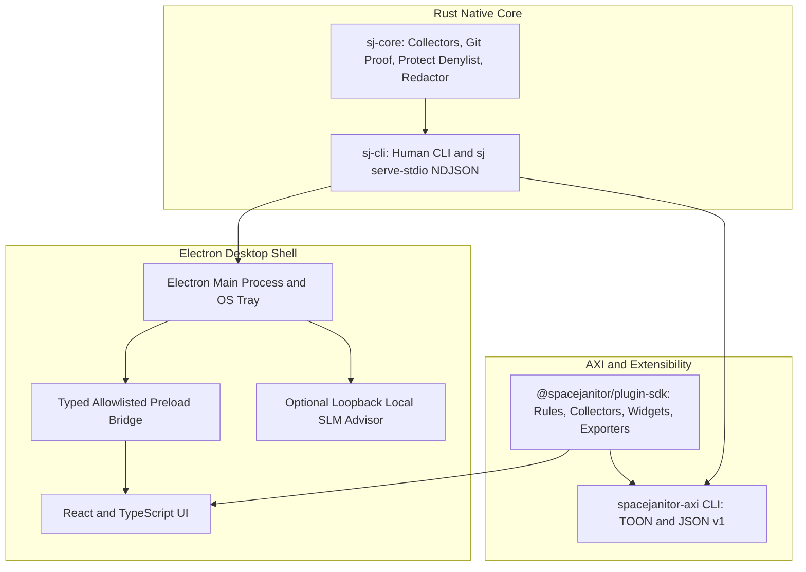
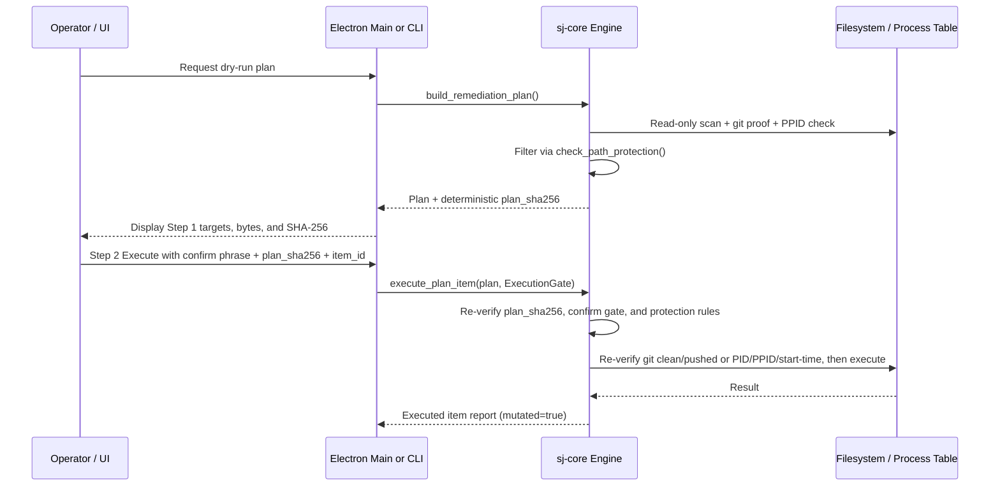

# SpaceJanitor Architecture

SpaceJanitor uses a **two-layer hybrid architecture**: a native **Rust core engine** (`sj-core` + `sj-cli`) paired with a thin, tray-first **Electron desktop shell** (`apps/desktop` + `apps/ui`), an **AXI CLI & Plugin SDK** (`packages/cli`, `packages/plugin-sdk`), and an **optional loopback-only Local SLM Advisor**.

---

## Design Principles

1. **Dry-Run Default:** Every collector and planner defaults to read-only inspection. Mutating operations require an explicit two-step execution gate bound to a deterministic SHA-256 plan digest.
2. **Engine-Core Ownership:** All path protection, git safety proofs, secret redaction, and execution gates live in `crates/sj-core`. Neither the UI, plugins, nor an optional SLM can bypass `sj-core`.
3. **Minimal Tray Footprint:** When the Electron window is closed or minimized to the system tray, the main process destroys the `BrowserWindow` renderer—eliminating Chromium's ~150–300 MiB idle renderer footprint while keeping the Rust tray bridge lightweight.
4. **Fail-Closed Protection:** Unreadable directories, dangling symlinks, unresolvable `cwd`, or recycled PIDs cause `sj-core` to deny or abort rather than guess.

---

## Component Architecture

---

## Two-Step SHA-256 Remediation Sequence

Every destructive action (Trash cleanup, verified orphan worktree pruning, or `PPID=1` process reaping) follows the same deterministic two-step handshake:

---

## Process & IPC Boundary Model

### Electron Sandbox Invariants (`apps/desktop`)
- **`contextIsolation: true`**, **`nodeIntegration: false`**, **`sandbox: true`** on all renderer windows.
- **Typed Allowlisted IPC:** `preload` exposes only explicit invoke channels (e.g., `scan`, `memory`, `blockers`, `plan`, `execute`)—never raw `fs`, `child_process`, or arbitrary shell execution.
- **No Shell Interpolation:** Spawning `sj serve-stdio` or external git probes uses `execFile` / `spawn` with explicit argument arrays (`shell: false`).
- **Close-to-Tray Lifecycle:** Closing the window destroys the `BrowserWindow` instance; reopening from the system tray recreates the renderer on demand.

### Sidecar Protocol (`sj serve-stdio`, M4)
- Communicates over **NDJSON JSON-RPC 2.0** on `stdin`/`stdout` between Electron Main (or external hosts) and the `sj` binary.
- All responses conform to versioned `spacejanitor.*.v1` envelopes (`spacejanitor.storage.v1`, `spacejanitor.trash.v1`, `spacejanitor.orphans.v1`, `spacejanitor.memory.v1`, `spacejanitor.blockers.v1`, `spacejanitor.mcp_audit.v1`, `spacejanitor.proposal.v1`).

---

## Cross-Platform Collector Matrix

| Domain | macOS (`darwin` `arm64`/`x64`) | Linux (`linux` `x64`/`arm64`) | Windows (`win32` `x64`/`arm64`) |
|---|---|---|---|
| **Storage & Trash** | `df -k`, `jwalk` inode-deduped scan, `tmutil listlocalsnapshots`, `~/.Trash` | `df -k` / `statvfs`, `jwalk`, `$XDG_DATA_HOME/Trash`, `/var/log/journal` | Win32 volume free space, `jwalk`, `$Recycle.Bin`, `%LOCALAPPDATA%\Temp`, WSL2 `.vhdx` |
| **True Memory Footprint** | `top -l 1` (`MEM` + `CMPRS` + `#PORTS`), `vm_stat`, `sysctl vm.swapusage` | `/proc/<pid>/smaps_rollup` (`Pss` + `SwapPss`), `/proc/meminfo`, `swapon --show` | `Win32_Process` (`WorkingSetSize`, `PrivatePageCount`, `HandleCount`), pagefile, WSL2 `Vmmem` |
| **Kernel / VFS Blockers** | `kern.num_vnodes`/`maxvnodes`, `kern.num_files`, `fseventsd`, Mach ports, `U`-state | `fs.inotify.max_user_watches`, `/proc/sys/fs/file-nr`, `D`-state/zombies, journald | Handle spikes, NonPaged/Paged pool, Defender/Search exclusions, pagefile saturation |
| **Orphan Work & Processes** | Recursive `.git` proof + `PPID=1` + non-recursive `lsof -Fn -d cwd` (never `lsof +D`) | Recursive `.git` proof + `PPID=1` + `/proc/<pid>/cwd` non-blocking check | Recursive `.git` proof + WMI parent PID tree + non-recursive handle CWD check |

---

## Architecture Decision Records & PRDs

- **ADRs:**
  - [ADR-001 — Desktop & Core Architecture (Rust Core + Electron Shell)](./adr/ADR-001-desktop-runtime-tauri-vs-electron.md)
  - [ADR-002 — Cross-Platform OS Telemetry & Orphan Safety Model](./adr/ADR-002-cross-platform-os-telemetry-and-orphan-safety.md)
  - [ADR-003 — AXI CLI Output & Extensible Plugin Contract](./adr/ADR-003-axi-cli-and-plugin-contract.md)
  - [ADR-004 — Zero-Leak Privacy & Two-Step Remediation Gate](./adr/ADR-004-privacy-zero-leak-and-two-step-remediation.md)
  - [ADR-005 — On-Demand Tiny Local SLM Cleanup Advisor](./adr/ADR-005-local-slm-cleanup-advisor.md)
- **PRDs:**
  - [PRD-001 — Core Storage, Trash & Orphan Work Engine](./prd/PRD-001-core-storage-and-orphan-work-engine.md)
  - [PRD-002 — True Memory Footprint & OS-Blocker Forensics](./prd/PRD-002-memory-footprint-and-os-blocker-forensics.md)
  - [PRD-003 — Cross-Platform Desktop App](./prd/PRD-003-cross-platform-desktop-app.md)
  - [PRD-004 — AXI CLI & Plugin Ecosystem](./prd/PRD-004-axi-cli-and-plugin-ecosystem.md)
  - [PRD-005 — On-Demand Local SLM Cleanup Advisor](./prd/PRD-005-local-slm-cleanup-advisor.md)
